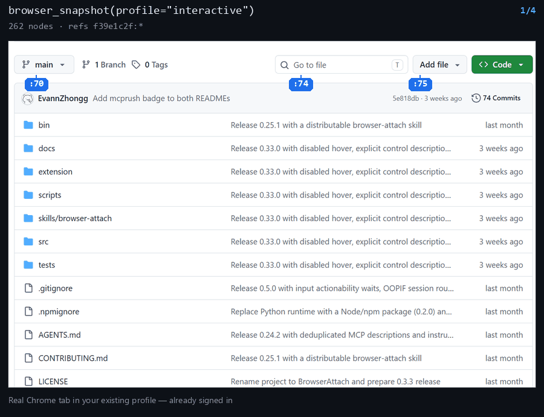

# BrowserAttach

<p align="center">
  <strong>Attach an MCP client to the browser you already use.</strong><br>
  <strong>English</strong> · <a href="README.zh.md">简体中文</a>
</p>

[](https://m8ven.ai/mcp/evannzhongg-browserattach-kisqie?s=readme) [](https://glama.ai/mcp/servers/EvannZhongg/BrowserAttach) [](https://www.agensi.io/skills/browserattach) [](https://mcprush.com/to/browserattach-mcp?ref=badge) [](https://deepwiki.com/EvannZhongg/BrowserAttach)

[](https://www.npmjs.com/package/@evan_zhong/browser-attach) [](LICENSE)

Your agent can read files and call APIs, but it cannot touch the page you are already signed in to. BrowserAttach lets an MCP client drive the Chrome / Edge tabs you already have open and already signed in — through a locally paired extension, with no remote debugging port and no separate automation browser.

[npm](https://www.npmjs.com/package/@evan_zhong/browser-attach) · [Usage guide](docs/USAGE.md) · [Architecture](docs/ARCHITECTURE.md) · [Agent integration](docs/AGENT-INTEGRATION.md) · [Test report](docs/TEST-REPORT.md) · [Issues](https://github.com/EvannZhongg/BrowserAttach/issues) · [Contributing](CONTRIBUTING.md)

<p align="center">
  
</p>

<p align="center"><sub>Claim → accessibility snapshot → native click → native typing → the page follows. Captured from a real Chrome profile, with no automation browser involved.</sub></p>

## What it solves

- **Your existing sign-in is reused** — actions run in the tabs that are already open and already logged in; no cookie export and no second browser to authenticate.
- **No debugging port, no browser restart** — nothing to relaunch with flags; the Hub listens on loopback only and pairs with the extension through a random key.
- **Explicit takeover instead of concurrent trampling** — discover, claim a tab exclusively, release it when done; one owner per tab and serialized operations.
- **The agent can actually read the page** — accessibility-tree snapshots with refs that survive actions, targeted reads of field values, popups and selected options, or strict CSS/XPath, HTML label, placeholder, AX role/name and rendered-text locators.
- **Input semantics stay transparent** — native pointer click/hover/drag/scroll is kept distinct from DOM-synthesized events, an unknown outcome is never replayed automatically, and ordinary operations never steal focus.
- **A whole sequence in one call** — 1–30 batch steps, conditional waits and `diff_since` observation; plus screenshots, uploads, dialogs, JavaScript evaluation, console/network logs and background `fetch` — 24 tools over standard stdio MCP.

## Requirements

- Node.js **22 or newer**, plus npm.
- Chrome / Edge **125 or newer** with permission to load unpacked extensions. Latest stable is recommended.
- An MCP client that speaks stdio MCP and can find Node/npm on `PATH`.

## Quick start

### 1. Install and pair

```sh
npm install --global @evan_zhong/browser-attach
browser-attach setup
```

`setup` prints a stable extension directory and starts the local Hub. The directory is usually:

- Windows: `%USERPROFILE%\.browser-attach\extension`
- macOS / Linux: `~/.local/share/browser-attach/extension`

Open `chrome://extensions` or `edge://extensions`, enable developer mode, choose "Load unpacked" and load that directory. Load it once for every browser profile you want to expose; the extension options page lets you set a recognizable profile name.

Or without a global install:

```sh
npx --yes --package=@evan_zhong/browser-attach@latest browser-attach setup
```

### 2. Configure the MCP client

Merge the following into your client's MCP configuration, or see [mcp-config.json](mcp-config.json):

```json
{
  "mcpServers": {
    "browser_attach": {
      "command": "npx",
      "args": ["--yes", "--package=@evan_zhong/browser-attach@latest", "browser-attach", "mcp"]
    }
  }
}
```

On Windows clients that require a full command extension, use `npx.cmd`. With a global install you can also configure `"command": "browser-attach", "args": ["mcp"]`. Restart the MCP client to discover the tools.

`@latest` selects the package at launch; upgrading an existing pair is coordinated at startup. The first extension load, and pairs still on an older protocol, need one manual extension reload — see [local data and upgrades](#local-data-and-upgrades).

Host entry points are collected in [agent integration](docs/AGENT-INTEGRATION.md), and the connection parameters, JSON/TOML examples and verification steps are in the [setup reference](skills/browser-attach/references/setup.md); other clients use the stdio entry above.

The npm package includes an optional [browser-attach skill](skills/browser-attach/SKILL.md) with setup, recovery and cross-site recipes. Copy the whole `skills/browser-attach` directory to your host's skill location if desired; npm installation does not register it with the host.

### 3. Start driving

1. `browser_discover(kind="browsers")` → `browser_discover(kind="tabs")` to confirm the browser, tab title and URL.
2. `browser_claim_tab` with the `tab_id` from `discover(kind="tabs")` (optional `expected_url` / `expected_title` exact guards) to take control and receive this connection's `tab_handle`.
3. `browser_snapshot` to get element `ref`s, then click, fill or run other actions.
4. Observe when the next decision needs new state, and finish with `browser_tab_control(action="release")`. Use `snapshot(diff_since="latest")` or action `observe:{diff_since:"latest"}` for page changes; inspect `mode/reset_reason` and finish pagination. A full-page refresh is not required after every action.

When titles change often, omit `expected_title` and check the identity returned by claim instead. Elements may be addressed by `ref` or by a `selector` re-resolved on every call; design trade-offs: [architecture notes](docs/ARCHITECTURE.md#设计取舍).

Claiming and ordinary input never activate a tab or window; call `browser_tab_control(action="activate")` explicitly when foreground rendering is needed. When an outcome is unknown, observe again first and avoid duplicate submissions. Full parameters, pagination, uploads and input semantics: [usage guide](docs/USAGE.md).

## Tools

| Tool | Purpose |
| --- | --- |
| `browser_discover` | `kind=browsers/tabs`; discover browser profiles, tab identity and control status |
| `browser_claim_tab` | Exclusively claim a discovered tab |
| `browser_open_tab` / `browser_tab_control` | Create a tab, optionally claim it with `claim:true`; explicit `release/activate/close` |
| `browser_fetch` | Read one HTTP(S) URL in a temporary background tab using the profile's sign-in; `text`/`html`/`json`, optional HTTP status and cursor continuation |
| `browser_snapshot` / `browser_read_text` | AX snapshot, literal name/value query with actionable refs, and page text |
| `browser_read_control` | Control state, related popups and active/selected options; preserves existing refs |
| `browser_wait` | Read-only checks with uniform expected/actual, pass/fail/unavailable and safe read retry; one top-level condition or `checks[]` |
| `browser_click` / `browser_hover` / `browser_drag` / `browser_select_option` / `browser_type` / `browser_fill` / `browser_press_key` / `browser_scroll` | Native/DOM input, pointer hover and drag, option selection, character typing and scrolling |
| `browser_batch` | Run 1–30 click/fill/type/press_key/hover/scroll/select_option/wait steps in one queue; stops on the first failure and returns partial results |
| `browser_navigate` | HTTP(S)/file navigation, back/forward and load waiting; local destinations require file access |
| `browser_handle_dialog` | alert, confirm, prompt |
| `browser_upload_file` | Native file input or a chooser captured by `click(capture_file_chooser=true)` |
| `browser_screenshot` | Viewport or full-page PNG with coordinate mapping |
| `browser_evaluate` | Main-page JS evaluation, promise awaiting, bounded results |
| `browser_logs` | Read `kind=console/network/navigation` with independent cursors; buffered reads survive blank or unresponsive pages |

## Local data and upgrades

| Platform | Default data directory |
| --- | --- |
| Windows | `%USERPROFILE%/.browser-attach` |
| macOS / Linux | `${XDG_DATA_HOME:-~/.local/share}/browser-attach` |

Override it explicitly with the absolute path `BROWSER_ATTACH_HOME`. The Windows default avoids AppData, which packaged hosts may virtualize; no other host's private cache is searched or merged automatically. The directory holds the pairing configuration, Hub logs and the stable extension copy, and depends on neither the clone location, the client working directory nor the npm cache. If you already use a custom directory, keep using the same environment variable or `--config` instead of accidentally creating a second pairing under the new default.

A host assembly step that writes the client entry pins the absolute paths of the current Node, CLI and the actual pairing file and sets `BROWSER_ATTACH_HOME`; it works together with a custom `--config`. When the MCP launches the Hub it passes the same absolute pairing path and directory, so different launch environments cannot derive a second configuration. See [agent integration](docs/AGENT-INTEGRATION.md).

To upgrade, install again with the command from step 1 and reconnect the MCP client. With `@latest` and a pair on 0.17 or newer the restart is enough; a pair still on an older protocol needs `browser-attach stop`, a restart and one manual extension reload. Custom pairing paths, ports and extension directories are retained, closed browser profiles update when they next connect, and an older MCP package cannot downgrade a newer Hub or installed extension.

An upgrade waits for extension cleanup and confirms the new version after reload; cleanup or reload failures are reported instead of replaying page actions. Manual reload remains available on the extension options page for recovery, and Hub and extension versions must match for page control. The default port is `47831`; choose another port with `setup --port` when creating a pairing.

## Architecture and boundaries

```text
MCP client → Node.js stdio MCP → 127.0.0.1 Hub
                                  ↕ local pairing
                          Chrome / Edge MV3 extension
                                  ↓ chrome.debugger / CDP
                               existing HTTP(S) / authorized file:// tabs
```

Each MCP connection holds its own control and handles cannot be used across connections. Disconnecting or stopping debugging releases control. The client endpoint requires a Bearer key and rejects web page Origins; the extension verifies a fixed Origin, key and version. `browser_evaluate` can read and write data with the page's existing sign-in state; a timeout or error may already have had an effect and must not be replayed automatically. No generic CDP tool is exposed.

Logs are collected from claim time, survive navigation and are cleared on release, with bounded buffers that report `data_loss` on eviction. Buffered reads use the existing claim without requiring a supported or responsive current page; capture changes still require page access. Network logs store lifecycle metadata and available initiators by default; an explicit capture reads bounded, redacted headers/bodies of subsequent XHR/fetch requests without changing caches or intercepting traffic. Navigation requests and commits remain separate observations. Buffer limits and parameters: [usage guide](docs/USAGE.md#诊断日志).

The extension holds debugger permission and client actions can use existing site sign-in state; only connect clients you trust. Web page content must not be treated as user authorization. The pairing key and the generated `config.generated.js` must not be committed or published; the packaging check rejects packages that contain that file.

Chrome / Edge HTTP(S) pages and existing ordinary `file://` tabs with extension file access enabled are supported, and file access is checked during discovery, claim, operations and navigation. `open_tab` and `fetch` still accept HTTP(S) only. Browser internal pages, arbitrary extension pages, download management, network interception and Firefox / WebKit remain outside scope, and built-in PDF viewer content is browser-dependent. Native pointer input requires an unsuspended tab in a non-minimized window; an unmodified left single click may target an inactive tab, while hover, drag and other click variants require an active tab. Full limits and failure modes: [usage guide](docs/USAGE.md#限制与排查).

## Local development

```sh
git clone https://github.com/EvannZhongg/BrowserAttach.git
cd BrowserAttach
npm ci
npm test
npm run test:package
```

Run the source directly and pair the extension in the repository:

```sh
node bin/browser-attach.mjs setup --extension-dir ./extension
node bin/browser-attach.mjs mcp
```

Development mode deliberately uses the repository extension path. For normal installs, use `setup` without `--extension-dir` so it keeps working after the repository moves.

Real-browser tests need a Chromium / Edge executable that allows loading extensions from the command line; the path is supplied by the developer:

```sh
npm run test:live -- --executable /path/to/chromium --family chromium
npm run test:interaction -- --executable /path/to/chromium --family chromium
npm run test:interaction -- --tab-indicators --executable /path/to/chromium --family chromium
npm run test:upgrade -- --executable /path/to/chromium
```

These tests use temporary profiles and local fixtures. Coverage and limits: [test report](docs/TEST-REPORT.md); implementation and design trade-offs: [architecture](docs/ARCHITECTURE.md).

## Contributing

Reproducible issues via [Issues](https://github.com/EvannZhongg/BrowserAttach/issues), or Pull Requests. Please include Node, OS, browser and extension versions, and remove pairing keys and private page data. See [CONTRIBUTING.md](CONTRIBUTING.md) for the process.

Released under the [MIT License](LICENSE).
