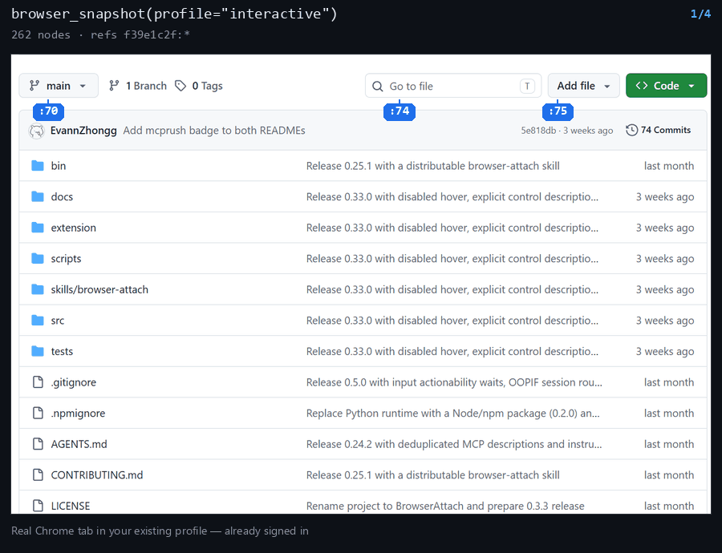

# BrowserAttach

<p align="center">
  <strong>把 MCP 客户端接入你正在使用的浏览器。</strong><br>
  <a href="README.md">English</a> · <strong>简体中文</strong>
</p>

[](https://m8ven.ai/mcp/evannzhongg-browserattach-kisqie?s=readme) [](https://glama.ai/mcp/servers/EvannZhongg/BrowserAttach) [](https://www.agensi.io/skills/browserattach) [](https://mcprush.com/to/browserattach-mcp?ref=badge) [](https://deepwiki.com/EvannZhongg/BrowserAttach)

[](https://www.npmjs.com/package/@evan_zhong/browser-attach) [](LICENSE)

你的 Agent 能读写文件、能调用 API，却碰不到你屏幕上那个已经登录的页面。BrowserAttach 让 MCP 客户端直接操作你已打开、已登录的 Chrome / Edge 标签页 —— 本机扩展配对，不需要远程调试端口，也不需要另起一个没有登录态的自动化浏览器。

[npm](https://www.npmjs.com/package/@evan_zhong/browser-attach) · [使用指南](docs/USAGE.md) · [架构与设计](docs/ARCHITECTURE.md) · [Agent 集成](docs/AGENT-INTEGRATION.md) · [验证报告](docs/TEST-REPORT.md) · [问题反馈](https://github.com/EvannZhongg/BrowserAttach/issues) · [贡献指南](CONTRIBUTING.md)

<p align="center">
  
</p>

<p align="center"><sub>接管 → 可访问性快照 → 原生点击 → 逐字原生输入 → 页面随之跳转。取自真实 Chrome 配置，没有自动化浏览器参与。</sub></p>

## 解决什么问题

- **复用你已有的登录态** —— 动作发生在已经打开、已经登录的标签页里，不导出 cookie，也不用为第二个浏览器重新登录。
- **不需要调试端口，也不需要重启浏览器** —— 不必带参数重启 Chrome / Edge；Hub 仅监听 loopback，通过随机密钥与本机扩展配对。
- **明确接管，而不是并发抢占** —— 发现、独占 claim、完成后释放；同一标签只有一个 owner，操作串行排队。
- **让 Agent 真正读懂页面** —— 可访问性树快照与跨动作稳定的 ref，按需读取字段值、弹层与已选选项，也可用严格 CSS/XPath、HTML label、placeholder、AX role/name 定位。
- **输入语义保持透明** —— 原生指针 click/hover/drag/scroll 与 DOM 合成事件明确区分，结果未知时不自动重放，普通操作不抢焦点。
- **一次调用跑完一串动作** —— 1–30 步 batch、条件等待与 `diff_since` 差分观察；另有截图、上传、对话框、JavaScript 求值、console/network 日志与后台 `fetch`，共 24 个标准 stdio MCP 工具。

## 环境要求

- Node.js **22 或更新版本**，以及 npm。
- Chrome / Edge **125 或更新版本**，且允许加载未打包扩展。推荐使用最新稳定版。
- 支持 stdio MCP 的客户端，能从 `PATH` 找到 Node/npm。

## 快速开始

### 1. 安装与配对

```sh
npm install --global @evan_zhong/browser-attach
browser-attach setup
```

`setup` 会输出稳定的扩展目录并启动本地 Hub。扩展目录通常是：

- Windows：`%USERPROFILE%\.browser-attach\extension`
- macOS / Linux：`~/.local/share/browser-attach/extension`

打开 `chrome://extensions` 或 `edge://extensions`，启用开发者模式，选择“加载已解压的扩展程序”，加载该目录。每个需要接入的浏览器配置分别加载一次；扩展选项可设置容易辨认的配置名称。

也可以不全局安装：

```sh
npx --yes --package=@evan_zhong/browser-attach@latest browser-attach setup
```

### 2. 配置 MCP 客户端

将以下配置合并到客户端的 MCP 配置中，或参考 [mcp-config.json](mcp-config.json)：

```json
{
  "mcpServers": {
    "browser_attach": {
      "command": "npx",
      "args": ["--yes", "--package=@evan_zhong/browser-attach@latest", "browser-attach", "mcp"]
    }
  }
}
```

Windows 客户端若要求完整命令扩展名，使用 `npx.cmd`。已全局安装时，也可以配置 `"command": "browser-attach", "args": ["mcp"]`。重启 MCP 客户端后发现工具。

`@latest` 在启动时选择包版本；升级已有配对会在启动时协调。首次加载扩展，以及仍停留在更旧协议的配对，需要手动重载一次扩展，详见[本机数据与升级](#本机数据与升级)。

各宿主的接入入口见 [Agent 集成](docs/AGENT-INTEGRATION.md)，连接参数、JSON/TOML 示例与验证步骤在 [Setup reference](skills/browser-attach/references/setup.md)；其他客户端直接使用上面的 stdio 配置。

npm 包附带可选的 [browser-attach skill](skills/browser-attach/SKILL.md)，提供配置、恢复和跨站点操作配方。按需将整个 `skills/browser-attach` 目录复制到宿主的 skill 目录；npm 安装不会向宿主注册它。

### 3. 开始操作

1. `browser_discover(kind="browsers")` → `browser_discover(kind="tabs")`，确认浏览器、标签页标题和 URL。
2. `browser_claim_tab`，用 `discover(kind="tabs")` 的 `tab_id` 接管（可选 `expected_url` / `expected_title` 精确校验），取得本连接的 `tab_handle`。
3. `browser_snapshot` 取得元素 `ref`，再执行点击、填写或其他动作。
4. 下一步依赖新状态时重新观察，结束时调用 `browser_tab_control(action="release")`。用 `snapshot(diff_since="latest")` 或动作的 `observe:{diff_since:"latest"}` 获取页面变化，检查 `mode/reset_reason` 并完成分页，无需每步刷新整页。

标题易变时省略 `expected_title`，改为核对 claim 返回的当前身份。元素可用 `ref` 或每次重新解析的 `selector` 定位；设计取舍见 [架构说明](docs/ARCHITECTURE.md#设计取舍)。

接管和普通输入不会主动激活标签或窗口；需要前台渲染时显式调用 `browser_tab_control(action="activate")`。操作结果未知时先重新观察，避免重复提交。完整参数、分页、上传与输入语义见 [使用指南](docs/USAGE.md)。

## 工具

| 工具 | 用途 |
| --- | --- |
| `browser_discover` | `kind=browsers/tabs`，发现浏览器配置、标签身份及控制状态 |
| `browser_claim_tab` | 独占接管已发现的标签 |
| `browser_open_tab` / `browser_tab_control` | 创建标签，可用 `claim:true` 同时接管；显式 `release/activate/close` 释放控制、激活或关闭已接管的标签 |
| `browser_fetch` | 在临时后台标签中复用登录态读取一个 HTTP(S) URL；支持 `text`/`html`/`json`、可选 HTTP 状态和游标续读 |
| `browser_snapshot` / `browser_read_text` | AX 快照、按字面名称/value 查询及可操作引用、正文 |
| `browser_read_control` | 定向读取控件、关联弹层及活动/选中选项，保留已有 refs |
| `browser_wait` | 单项或 checks[] 多项只读检查，统一返回期望/实际、三态结果与安全重查信号 |
| `browser_click` / `browser_hover` / `browser_drag` / `browser_select_option` / `browser_type` / `browser_fill` / `browser_press_key` / `browser_scroll` | 原生/DOM 输入、指针悬停与拖拽、下拉选择、逐字输入与滚动 |
| `browser_batch` | 单队列顺序执行 1–30 步 click/fill/type/press_key/hover/scroll/select_option/wait，失败即停并返回部分结果 |
| `browser_navigate` | HTTP(S)/file 导航、后退前进与加载等待 |
| `browser_handle_dialog` | alert、confirm、prompt |
| `browser_upload_file` | 原生文件 input 或通过 `click(capture_file_chooser=true)` 捕获的选择器 |
| `browser_screenshot` | 视口或整页 PNG，附坐标映射 |
| `browser_evaluate` | 主页面 JS 求值、Promise 等待、有界结果 |
| `browser_logs` | 用 `kind=console/network` 选择控制台、异常或请求日志，支持过滤和游标续读 |

## 本机数据与升级

| 平台 | 默认数据目录 |
| --- | --- |
| Windows | `%USERPROFILE%/.browser-attach` |
| macOS / Linux | `${XDG_DATA_HOME:-~/.local/share}/browser-attach` |

可通过绝对路径 `BROWSER_ATTACH_HOME` 显式覆盖。Windows 默认避开可能被打包宿主虚拟化的 AppData；不会搜索或自动合并其他宿主的私有缓存。目录包含配对配置、Hub 日志及稳定的扩展副本；不依赖 clone 位置、客户端工作目录或 npm 缓存。已有自定义目录请继续使用相同环境变量或 `--config`，不要在新默认目录意外创建另一套配对。

宿主装配步骤写入客户端条目时，会固定当前 Node、CLI 和实际配对文件的绝对路径，并设置 MCP 的 `BROWSER_ATTACH_HOME`；支持与自定义 `--config` 一起使用。MCP 启动 Hub 时继续传入同一绝对配对路径及目录，避免不同启动环境重新推导出另一份配置。详见 [Agent 集成](docs/AGENT-INTEGRATION.md)。

升级时用第 1 步的同一命令重新安装，然后重连 MCP。使用 `@latest` 且配对已运行 0.17 或更高版本时，重连即可；仍停留在更旧协议时需先执行 `browser-attach stop`、重启 MCP，并手动重载一次扩展。自定义配对路径、端口和扩展目录会保留，未打开的浏览器 profile 在下次连接时更新，旧 MCP 包不会降级新版 Hub 或已安装扩展。

升级会等待扩展清理，并在重载后确认新版本；清理或重载失败会明确报告，不重放页面动作。扩展设置页保留手动重新加载按钮用于恢复，正常页面控制仍要求 Hub 与扩展版本一致。默认端口为 `47831`，创建配对时可通过 `setup --port` 选择其他端口。

## 架构与使用边界

```text
MCP 客户端 → Node.js stdio MCP → 127.0.0.1 Hub
                                  ↕ 本机配对
                          Chrome / Edge MV3 扩展
                                  ↓ chrome.debugger / CDP
                              现有 HTTP(S) 标签页
```

每个 MCP 连接拥有独立控制权，句柄不能跨连接使用。断连或停止调试会释放控制。客户端端点要求 Bearer 密钥并拒绝网页 Origin；扩展验证固定 Origin、密钥和版本。`browser_evaluate` 可以使用页面现有登录态读写数据；超时或报错前可能已产生作用，不应自动重放。未暴露通用 CDP 工具。

日志从接管开始采集，跨导航保留，释放时清除；缓冲区有上限，淘汰会报告 `data_loss`。网络日志默认只记录生命周期元数据；显式 capture 才读取之后的 XHR/fetch 有界、脱敏 headers/正文，不改变缓存或拦截流量。缓冲上限与参数见[使用指南](docs/USAGE.md#诊断日志)。

浏览器扩展具有调试权限，客户端操作可使用现有网站登录态；只应将其接入你信任的 MCP 客户端。网页内容不应被视为用户授权。配对密钥和生成的 `config.generated.js` 不应提交或发布，打包检查会拒绝包含该文件的包。

支持 Chrome / Edge 的 HTTP(S) 页面，以及开启扩展文件访问权限后已打开的普通 `file://` 标签页；文件权限在发现、接管、操作和导航时都会检查。`open_tab` 与 `fetch` 仍只接受 HTTP(S)。浏览器内部页、任意扩展页、下载管理、网络拦截和 Firefox / WebKit 不在范围内，内置 PDF 查看器内容取决于浏览器。原生指针输入要求未暂停的标签及未最小化窗口；无修饰键的左键单击可在非活动标签尝试，hover、drag 及其他点击变体仍要求活动标签。完整边界与排查见[使用指南](docs/USAGE.md#限制与排查)。

## 本地开发

```sh
git clone https://github.com/EvannZhongg/BrowserAttach.git
cd BrowserAttach
npm ci
npm test
npm run test:package
```

直接运行源码并配对仓库中的扩展：

```sh
node bin/browser-attach.mjs setup --extension-dir ./extension
node bin/browser-attach.mjs mcp
```

开发模式有意使用仓库扩展路径。一般安装请使用不带 `--extension-dir` 的 setup，确保移动仓库后仍可运行。

真实浏览器测试需要一个允许命令行加载扩展的 Chromium / Edge 可执行文件，路径由开发者传入：

```sh
npm run test:live -- --executable /path/to/chromium --family chromium
npm run test:interaction -- --executable /path/to/chromium --family chromium
npm run test:interaction -- --tab-indicators --executable /path/to/chromium --family chromium
npm run test:upgrade -- --executable /path/to/chromium
```

这些测试使用临时配置和本地 fixture。测试覆盖与限制见 [验证报告](docs/TEST-REPORT.md)，实现与设计取舍见 [架构与设计](docs/ARCHITECTURE.md)。

## 参与贡献

欢迎通过 [Issues](https://github.com/EvannZhongg/BrowserAttach/issues) 提交可复现问题，或提交 Pull Request。请附上 Node、系统、浏览器与扩展版本，移除配对密钥和网页隐私数据。具体流程见 [CONTRIBUTING.md](CONTRIBUTING.md)。

本项目采用 [MIT License](LICENSE)。
